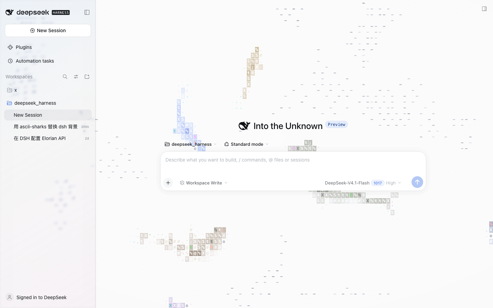
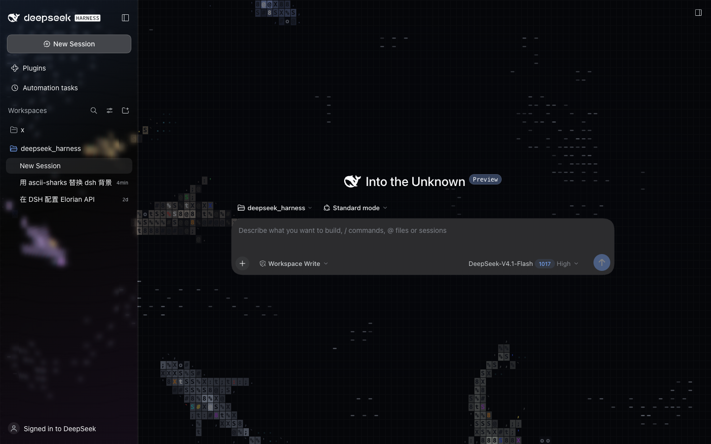

# dsh-asciishark

把 [stackedlol/ascii-sharks](https://github.com/stackedlol/ascii-sharks) 的 ASCII 鲨鱼海洋动画做成 **DeepSeek Harness Web/Desktop 客户端的动态背景**。

> **上游授权待确认（2026-10-23）**：已向作者提交 [MIT 授权申请](https://github.com/stackedlol/ascii-sharks/issues/1#issuecomment-6355506507)，尚未获得授权。维护者原创贡献的 MIT 许可不覆盖上游代码；在授权确认前，请勿再分发本仓库或插件包。各部分的授权范围见 [第三方声明](THIRD_PARTY_NOTICES.md)。

这是一个 DSH 客户端插件包：海洋铺在整扇窗的底层，**左侧边栏**是苹果 Liquid Glass 风格的贴边液态玻璃窗（SVG 位移折射 + 色散边 + 模糊背景，无圆角/无内缩/无光晕），**对话主栏**是更清透的玻璃，鱼群和鲨鱼在两栏后面游动；右侧文档/终端栏、菜单、弹窗保持原本的不透明表面。

| 浅色主题（水墨玻璃） | 深色主题（深海玻璃） |
| --- | --- |
|  |  |

## 兼容性

| 环境 | 状态 | 说明 |
| --- | --- | --- |
| DSH Desktop · macOS | ✅ 已实测（0.10.0） | 本仓库的开发/验证环境 |
| DSH Desktop · Windows | ✅ 设计兼容 | 同一套 Web 前端与 DOM 槽位，无平台相关 API；已提供 PowerShell 安装脚本。若布局有细微差异欢迎开 issue |
| DSH Web（浏览器，任意系统） | ✅ 兼容 | Chrome / Edge 等 Chromium 内核；无需安装脚本，按下面的手动步骤把插件放到 profile 即可 |
| DSH Desktop · Linux | ⚠️ 未验证 | 布局与 Web 一致，理论可用；暂无安装脚本，可参照手动安装 |

插件本身不依赖任何操作系统 API：DOM 选择器、Canvas 2D、Web Worker + OffscreenCanvas、CSS/SVG 滤镜全部在 Chromium 页面内运行。平台差异只在**安装路径和脚本**上；Windows 与 macOS 的 DSH Home 都是 `用户目录/.dsh`。

## 行为

- **左侧栏（New Session 那一栏）= 贴边液态玻璃窗**：铺满整列、无圆角、无内缩、无投影、无光晕、无 1px 高光边；玻璃本体用**逐像素位移贴图 + SVG 滤镜**做边缘折射（`feDisplacementMap`，双通道不同缩放产生色散边），玻璃底图来自对海洋画布的**低帧率快照**，再叠加一层很淡的冷色玻璃色调；文字保持清晰。
- **对话主栏**：更清透的玻璃（浅色底色 50%），鱼群、鲨鱼和水花都能在消息背后看见，阅读不受影响。
- **右侧栏 / 菜单 / 弹窗**：保持原生不透明表面，不受影响。
- **6 种鲨鱼**：锤头鲨 `hammerhead`、经典鲨 `classic`、虎鲨 `tiger`、长尾鲨 `thresher`、灰鲭鲨 `mako`、斑竹鲨 `zebra`，体型 0.9→0.46 递减；鱼群照旧成群、报警、被追捕并重新入场。
- **跟随主题自动适配**，切换外观时实时换挡：
  - 深色主题：原版彩色 ASCII 海洋 + 烟熏玻璃面板 + 深色液态玻璃左栏。
  - 浅色主题：动画反相成「白纸水墨」，左栏是带冷色折射的浅色玻璃，对话栏是半透明宣纸。
- 指针移动时鱼群躲避，点击水面溅起水花（canvas 为 `pointer-events: none`，不影响 UI 点击）。
- 窗口隐藏/切后台自动暂停；`prefers-reduced-motion: reduce` 时只画静止帧（上游库自带行为）。
- 卸载时逐项还原被改动的元素样式，实测热插拔后 DOM、样式、token 全部恢复原状。
- 性能：海洋模拟与绘制全部在 **Web Worker + OffscreenCanvas** 里跑（动画稳定 60fps，主线程几乎不参与）；玻璃滤镜约 8fps 对快照重算；窗口失焦自动暂停（详见下方性能优化）。

## 安装（DSH Desktop）

### macOS / Linux（bash）

```sh
git clone https://github.com/yxflc11/dsh-asciishark.git
cd dsh-asciishark
./install-desktop.sh
```

### Windows（PowerShell）

```powershell
git clone https://github.com/yxflc11/dsh-asciishark.git
cd dsh-asciishark
powershell -ExecutionPolicy Bypass -File .\install-desktop.ps1
```

仓库里已经提交了构建好的 `lib/`，**克隆后无需构建即可安装**。脚本把包复制到：

- macOS/Linux：`~/.dsh/profiles/desktop/node_modules/@local/dsh-client-ui-ascii-ocean/`
- Windows：`%USERPROFILE%\.dsh\profiles\desktop\node_modules\@local\dsh-client-ui-ascii-ocean\`

并在 profile 的 `cordis.patch.yml` 末尾追加 Loader 条目：

```yaml
- insert:
    - id: ui-ascii-ocean
      name: "@local/dsh-client-ui-ascii-ocean"
```

DSH 会通过 `dsh-hmr` 热重载 profile patch，**无需重启应用**；下次启动也会自动加载。

> 如果更新插件后窗口里还是旧效果（DSH 对「已在运行的客户端插件」做热替换有已知限制），刷新一次页面即可：macOS `⌘R`，Windows `Ctrl+R`，草稿会自动保留。

### 手动安装（任意系统 / DSH Web）

1. 把本仓库的 `lib/`、`package.json`、`README.md`、`LICENSE` 和 `THIRD_PARTY_NOTICES.md` 复制到 `<DSH Home>/profiles/desktop/node_modules/@local/dsh-client-ui-ascii-ocean/`（没有该目录就新建）；
2. 在上面那个 profile 的 `cordis.patch.yml` 末尾追加同样的 YAML 条目；
3. 刷新页面（`⌘R` / `Ctrl+R`）或重启 DSH。

如果需要重新构建：

```sh
npm install
npm run build
```

## 卸载

macOS / Linux：

```sh
./uninstall-desktop.sh
```

Windows：

```powershell
powershell -ExecutionPolicy Bypass -File .\uninstall-desktop.ps1
```

脚本会先移除 patch 行、等 HMR 卸载插件并还原 DOM 样式，再删除包目录（避免与热重载竞争）。卸载后立即恢复原样。

## 性能优化

目标：**动画优先（60fps 不降级），同时把 UI 主线程让出来。**

- **海洋搬进 Web Worker**：模拟 + ASCII 绘制全部跑在 worker 里，通过 `OffscreenCanvas` 直接画到页面的 canvas 上（CSS 反相/渐晕仍在主线程合成）。主线程不再跑每一帧的物理与文字绘制。
- **玻璃用低帧率快照**：worker 每 120ms 把侧栏区域的画面缩成半分辨率位图传回，主线程对这张快照做 SVG 折射滤镜；滤镜重算约 8fps，而不是跟着海洋每帧跑。
- **半分辨率滤镜 + transform 放大**：滤镜光栅面积降到 1/4（Retina 收益最大），因为本来就是模糊玻璃，观感几乎无差。
- **无 backdrop-filter**：不再实时采样整页背景，少一次全屏模糊合成。
- **DPR 上限 1.5**：Retina 下海洋画布像素减少约 44%。
- **失焦/隐藏暂停**：窗口失焦、最小化时 worker 停止渲染（省电）。
- **滤镜 2 次位移**（R + GB 双通道，取代 3 次），保留色散边但开销更低。

实测（headless Chromium，1440×900，6 鲨 + 200+ 鱼）：

| 指标 | 0.8.x | 0.9.0 | **0.10.0** |
| --- | --- | --- | --- |
| 动画帧率 | 30fps | 30fps | **~60fps** |
| 主线程忙碌占比 | ~56% | ~20% | **~0.5%** |
| 页面 rAF p99 | 33.4ms | 17.7ms | **17.7ms（稳定 60fps）** |
| 滤镜重算频率 | 30fps | ~8fps | **~8fps** |

## 独立预览

`preview/index.html`：不依赖 DSH 的独立页面，双击即可用浏览器打开（`ocean.global.js` 是本地打包的引擎，无需联网），展示同样的 6 种鲨鱼阵容：

```sh
open preview/index.html
```

## 打包

```sh
npm run pack:tgz
```

脚本会先创建 `dist/`，再生成 `dist/local-dsh-client-ui-ascii-ocean-0.10.0.tgz`，包含 `LICENSE` 和 `THIRD_PARTY_NOTICES.md`。上游授权待确认期间，请勿再分发该包；打包成功不代表获得授权。

## 目录

```
dsh-asciishark/
├── src/
│   ├── client.ts            # DSH 客户端插件（全窗海洋 + 左栏/对话栏局部 token）
│   ├── preview.ts           # 独立预览入口
│   └── ascii-sharks/        # 上游 ascii-sharks 源码副本
├── lib/
│   ├── index.js             # 宿主端半边（空 Cordis 插件）
│   └── client.js            # 浏览器端打包产物（esbuild IIFE）
├── preview/                 # 独立预览页 + 打包产物
├── docs/                    # 效果截图
├── backup/                  # 安装前自动备份的 profile patch
├── src/ocean-worker.ts      # Web Worker：模拟 + ASCII 渲染（OffscreenCanvas）
├── src/worker-source.generated.ts  # 构建时生成（已 gitignore）
├── build.mjs                # 两段式 esbuild 构建脚本
├── install-desktop.sh / .ps1
├── uninstall-desktop.sh / .ps1
├── LICENSE
└── THIRD_PARTY_NOTICES.md
```

## 实现要点

- 包声明 `dsh.client.platform = "web"` 并导出 `./client` 产物；DSH 的 client-modules 宿主把 `lib/client.js` 作为懒加载 CJS bundle 服务到 `/plugins`，浏览器端 Cordis 树以 `inject: ["theme"]` 应用插件。
- `apply(ctx)`：
  - 在 `body` 前置一层 `position: fixed; z-index: 0` 的全窗 canvas + 渐晕，`#root` 提到 `z-index: 1`；canvas 通过 `transferControlToOffscreen()` 交给 worker 渲染；
  - 把布局 frame 的背景清成透明，使海洋能透到 frame 后面的各栏；
  - 定位 `[data-slot="sidebar"]` 与 `[data-slot="main"]` 的父元素（即左栏和对话栏）：左栏清空自身填充 + 挂 `dsh-liquid-glass` 类，类内是一块**半分辨率快照 canvas**（每 120ms 由 worker 传回侧栏区域画面），再对快照施加 `blur + SVG 位移折射` 滤镜和一层很淡的冷色玻璃色调；无圆角、无内缩、无光晕、无 1px 高光边；对话栏内联 `--dsw-alias-bg-base / layer-1/2/3 / module-platform` 保持半透明可读；两套值随主题实时切换；
  - 监听 `theme/change` 换挡 canvas 反相/正常模式与渐晕；
  - 每 0.8s 做一次轻量 `ensure()`：列元素被 React 重新挂载、布局切换或样式被重置时自动补挂；
  - 全部登记在 `ctx.effect` 作用域内，卸载时移除 canvas/样式/定时器，并逐项还原 frame 与两栏被改动的内联样式。
- 右侧栏、菜单与弹窗使用各自原有的不透明 token / portal 层，天然不会被海洋影响。
- 引擎的 `ResizeObserver` 跟随窗口尺寸（侧栏折叠、右栏展开、窗口缩放都自动适配）。
- 玻璃滤镜只对 8fps 的半分辨率快照重新求值（而不是跟着海洋每帧跑）；海洋本身在 worker 里以 60fps 渲染，主线程只负责合成，因此动画顺滑且 UI 不卡。

## 致谢

- 动画算法与渲染器来自 [stackedlol/ascii-sharks](https://github.com/stackedlol/ascii-sharks)（本仓库 `src/ascii-sharks/` 为其源码副本）。
- 液态玻璃的折射/色散滤镜思路参考并改编自 [rdev/liquid-glass-react](https://github.com/rdev/liquid-glass-react)（MIT，© Max Rovensky，其又改编自 shuding/liquid-glass）。
- 第三方来源、许可和待确认状态见 [`THIRD_PARTY_NOTICES.md`](THIRD_PARTY_NOTICES.md)。

## License

维护者有权许可的原创贡献以 [MIT License](LICENSE) 发布。第三方代码遵循各自条款；该 MIT 许可不授予 `ascii-sharks` 上游代码及其打包副本的使用或再分发权利。`package.json` 的许可字段指向 [`THIRD_PARTY_NOTICES.md`](THIRD_PARTY_NOTICES.md)，以说明整个包的授权范围。

`src/ascii-sharks/` 来自上游 ascii-sharks 仓库，该仓库**没有声明许可证**（核查日期：2026-10-23）。维护者已在 [上游 Issue #1](https://github.com/stackedlol/ascii-sharks/issues/1#issuecomment-6355506507) 申请 MIT 授权，范围包括已引入的版本、后续修改、源码和插件/预览产物分发，以及下游用户权利。**申请已提交，授权尚未取得；在许可确认前，请勿再分发本仓库或插件包**。获得明确授权后，应按作者实际同意的条款更新本声明并随安装包保留完整版权及许可文本；若最终无法取得许可，需替换相关源码并重新构建产物。
